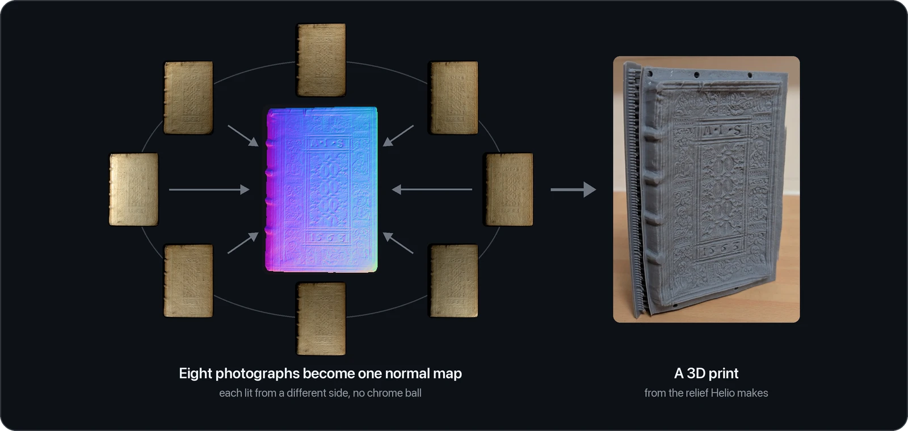
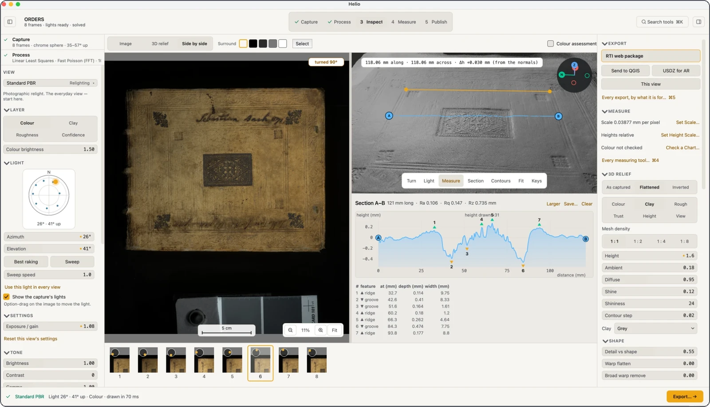
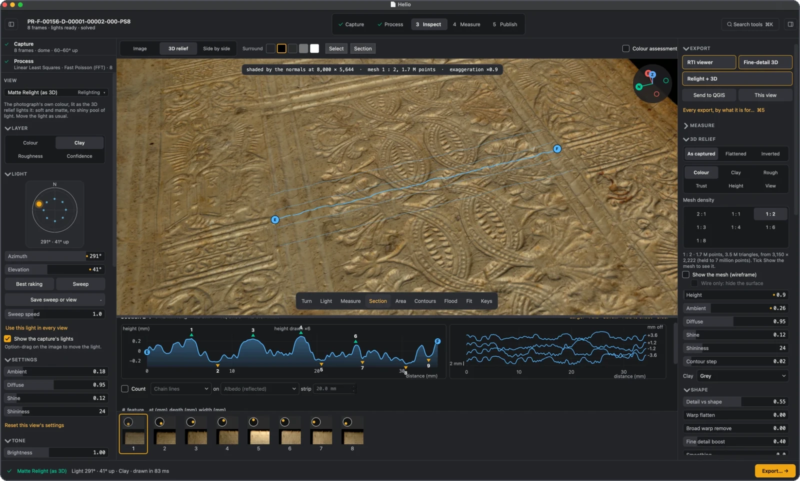
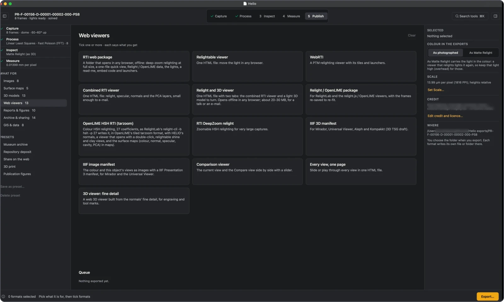

<p align="center"></p>

<p align="center"><b>Photometric stereo and RTI for cultural heritage</b></p>

<p align="center">
  
  
  
  
  
</p>

<p align="center">
  <a href="#getting-helio">Getting Helio</a> ·
  <a href="#what-it-does">What it does</a> ·
  <a href="docs/QUICKSTART.md">Quick start</a> ·
  <a href="#for-developers">For developers</a> ·
  <a href="https://github.com/sjm208/HELIO-RTI/issues">Issues</a>
</p>

---

Helio turns photographs of an object into its surface: which way it faces at
every point, how high it stands, and how it looks under any light. It is made
for bindings, manuscripts, prints, seals, coins and other heritage objects.

Photograph the object from one place with the light moved between frames.
Helio solves the surface, lets you relight it, read it in 3D and measure it,
and publishes it as pictures, publication sheets, meshes, web viewers,
archives and GIS layers.

<p align="center">
  <br>
  <sub>No chrome ball needed: from the shoot to a model ready to print in about ten minutes</sub>
</p>

<table>
  <tr>
    <td colspan="2" align="center">
      <br>
      <sub>Inspect: a binding relit, beside its 3D relief and a measured section</sub>
    </td>
  </tr>
  <tr>
    <td width="50%" align="center" valign="top">
      <br>
      <sub>The 3D relief, with a section and its profile</sub>
    </td>
    <td width="50%" align="center" valign="top">
      <br>
      <sub>Publish: every export, by what it is for</sub>
    </td>
  </tr>
</table>

## What it does

| Workspace | What you can do |
|---|---|
| **Capture** | Photographs in any order. The lights come from one or two chrome balls, a light file, a rig profile, or a dome you place them on by hand. Hand-held flash and near lamps are evened out. |
| **Process** | 8 normal solvers (least squares to specular-robust, sparse-outlier and near-field) and 10 depth methods. Quick looks in seconds, with a score to choose between them. |
| **Inspect** | 36 views, all relit live: relit, raking, curvature, openness, MSRM, specular, decomposition, quality. The 3D relief, a high-detail 3D window, light sweeps and turntable videos. |
| **Measure** | Scale, distances, sections and height profiles, ISO 4287 roughness, areas and volumes, ISO 25178 statistics, micro-features and tool marks. |
| **Publish** | Images, a publication sheet and an A3 plate, figures and reports; OBJ, STL, GLB, PLY, E57 and USDZ; offline web viewers and the RTI web package; heritage archives; GIS height maps, and **Send to QGIS** with Helio Relief, the QGIS plugin (in `qgis_plugin/`). |

Sessions are saved as `.helio` files. No GPU or deep-learning runtime is
needed; 16 GB of memory is enough for most captures.

## Getting Helio

### The ready-made Mac app

Download
[**Helio_4.0.dmg**](https://github.com/sjm208/HELIO-RTI/releases/latest/download/Helio_4.0.dmg)
(about 400 MB, from [Releases](https://github.com/sjm208/HELIO-RTI/releases)),
open it and double-click **Install Helio**. Apple silicon, macOS 13 or later. The app
is not code-signed: if macOS says it "is damaged", run **Install Helio** again.

### Run it from this folder (macOS or Windows)

No GitHub account or Git is needed. It takes about ten minutes, most of it
downloading.

1. **Download Helio.** On this page, click the green **Code** button, then
   **Download ZIP**. Unzip it somewhere you will keep it, such as Documents.

2. **Install Python 3.12** from
   [python.org/downloads](https://www.python.org/downloads/) (choose a 3.12
   version).
   - **Windows:** on the first screen of the installer, tick **Add python.exe
     to PATH**.
   - **macOS:** after installing, open the Python 3.12 folder in
     Applications and double-click **Install Certificates.command**.

3. **Open a terminal in the Helio folder.**
   - **macOS:** open **Terminal** (in Applications › Utilities), type `cd `
     (with a space), drag the Helio folder onto the window and press Return.
   - **Windows:** open the Helio folder in File Explorer, click the address
     bar, type `powershell` and press Enter.

4. **Set it up, once.** Copy each line, paste it into the terminal and press
   Enter. This makes a private Python for Helio inside its folder (`.venv`),
   so nothing else on the computer is changed.

   **macOS**

   ```bash
   python3.12 -m venv .venv
   ```

   ```bash
   .venv/bin/python -m pip install --upgrade pip
   ```

   ```bash
   .venv/bin/python -m pip install -r requirements.txt
   ```

   ```bash
   .venv/bin/python -m pip install --no-deps rvt-py==2.2.1
   ```

   **Windows**

   ```powershell
   py -3.12 -m venv .venv
   ```

   ```powershell
   .venv\Scripts\python -m pip install --upgrade pip
   ```

   ```powershell
   .venv\Scripts\python -m pip install -r requirements.txt
   ```

   ```powershell
   .venv\Scripts\python -m pip install --no-deps rvt-py==2.2.1
   ```

5. **Start Helio.** Double-click **Run Helio.command** (macOS) or
   **Run Helio.bat** (Windows) in the Helio folder. The first time, macOS may
   say it cannot check the file: right-click it, choose **Open**, then
   **Open**.

To update later, download the ZIP again, unzip it over the old folder (or
into a new one and repeat step 4).

> [!NOTE]
> Helio is developed and tested on macOS. On Windows it runs from source as
> above; the ready-made app is Mac-only for now. If anything goes wrong on
> Windows, please [open an issue](https://github.com/sjm208/HELIO-RTI/issues)
> with what the terminal says.

### Faster, with the Rust kernels (optional)

The heaviest arithmetic can run in Rust instead of NumPy, several times
faster. Helio works without it.

1. Install Rust from [rustup.rs](https://rustup.rs). On **Windows**, first
   install the [Visual Studio Build Tools](https://visualstudio.microsoft.com/visual-cpp-build-tools/)
   with **Desktop development with C++**.
2. In the terminal, in the Helio folder:

   **macOS**

   ```bash
   PYTHON=.venv/bin/python ./build_rust.sh
   ```

   **Windows**

   ```powershell
   .venv\Scripts\python -m pip install --no-deps .\helio_core_rs
   ```

### Building the Mac app yourself

`./build_helio3.sh` builds **Helio.app** with PyInstaller, runs the app's own
self-test and makes the disk image (Apple silicon). Run it with the Python you
set up: `PYTHON=.venv/bin/python ./build_helio3.sh`.

## For developers

```text
helio/            the processing engine
  application/    the solve, views, exports, publication sheet
  domain/         settings and the solver / depth / view registry
  core/           photometric stereo, depth, shading engines, metrology
  io/             loading, sessions, light files, exporters
  render/         the high-detail 3D viewer
helio_qt/         the desktop interface (PySide6)
helio_core_rs/    the Rust kernels (built with maturin)
qgis_plugin/      Helio Relief, the QGIS plugin
tests/            test scripts, fixtures and golden images
tools/            audits, benchmarks and the golden-image maker
docs/             notes, benchmarks and explainers
packaging/        icons, installer art and disk-image files
promotion/        the product page
```

<details>
<summary><b>Running the tests</b></summary>

<br>

Each test is a script that prints what it checked:

```bash
python tests/test_engines.py
```

`./run_tests.sh` runs them all, once with the Rust kernels (when built) and
once on the NumPy code. A few tests open a real eight-photograph capture with
a chrome ball. Those photographs are not in this repository; point
`HELIO_TEST_IMAGES` at a folder of your own capture and they use it, otherwise
they run what they can and skip the rest.

`python3 -m helio_qt.fullcheck` drives the whole program the way a person
would (every setting, view, export and menu command, on your capture or one it
makes) and writes a report of anything to fix. See
[docs/TESTING.md](docs/TESTING.md).

</details>

<details>
<summary><b>Environment variables</b></summary>

<br>

| Variable | Effect |
|---|---|
| `HELIO_NO_RUST=1` | use the NumPy kernels even when the Rust module is built |
| `HELIO_PROFILE=1` | print the time and peak memory of each stage of a solve (`HELIO_PROFILE_FILE=path` also writes it) |
| `HELIO_WORK_SCALE=0.5` | solve from photographs reduced to 50%, for machines short of memory |
| `HELIO_KEEP_PTM=1` | keep the PTM / HSH coefficients even when the memory plan calls the machine tight |
| `HELIO_MEMORY_GB=16` | pretend the machine has 16 GB, to see what the memory plan says |
| `HELIO_THREADS=n` | threads for the whole-image kernels |
| `HELIO_TEST_IMAGES=folder` | the capture the tests that need real photographs open |

See [docs/MIGRATION_RUST.md](docs/MIGRATION_RUST.md) for the memory plan and
the Rust kernels.

</details>

## Documentation

- [docs/QUICKSTART.md](docs/QUICKSTART.md): from photographs to a publication sheet.
- [docs/PRECISION_PS.md](docs/PRECISION_PS.md): shooting and processing to measure.
- [docs/BENCHMARK_DILIGENT.md](docs/BENCHMARK_DILIGENT.md): the solvers' accuracy on the DiLiGenT benchmark.
- [docs/blueprint.md](docs/blueprint.md): the architecture.
- In Helio: **Help › Getting Started**. Every control has a tooltip.

## Licence

MIT: see [LICENSE](LICENSE). Third-party notices are in
[THIRD_PARTY_NOTICES.md](THIRD_PARTY_NOTICES.md).
